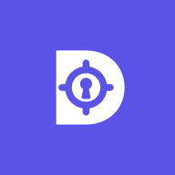
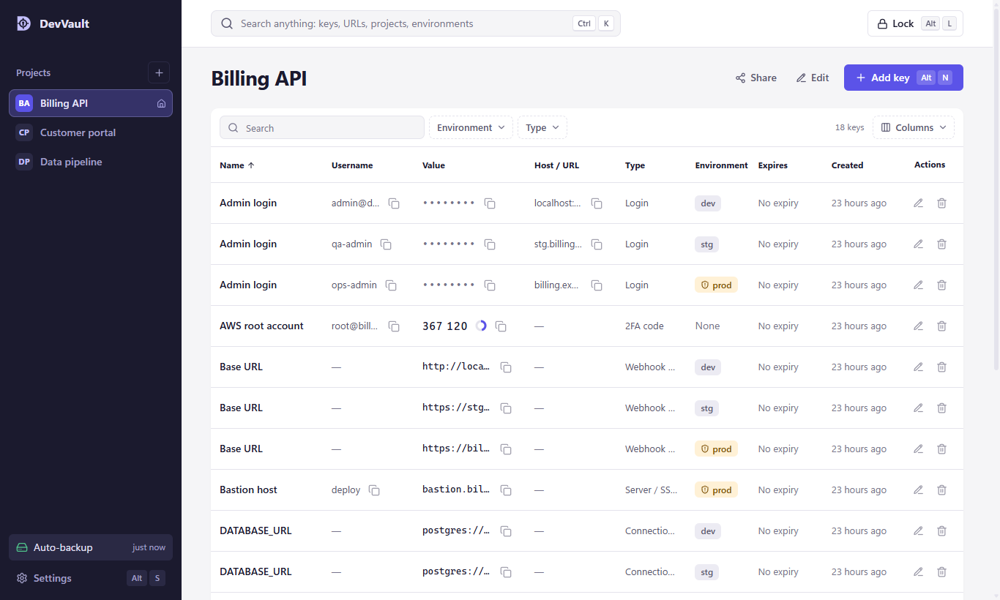
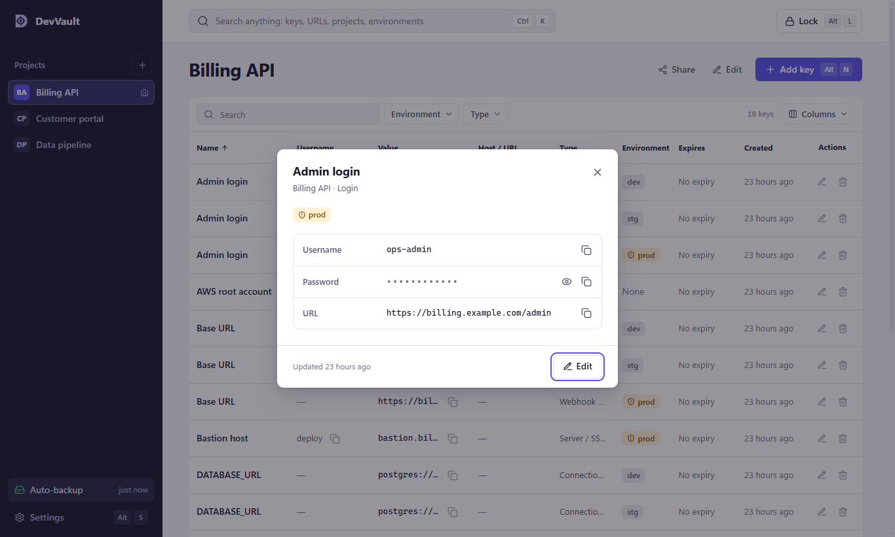
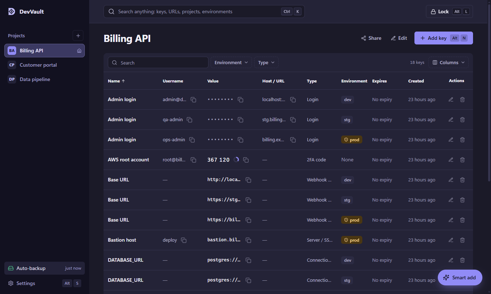

<div align="center">



# Developer Keys

**The values developers forget, encrypted on your own PC, one click away in Microsoft Teams.**


</div>

<p align="center">
  
</p>

Developer Keys keeps the values developers look up every day in one encrypted vault on your own machine. That covers environment URLs, test accounts, API tokens, connection strings, SSH keys and `.env` blocks. It runs as a personal tab in Microsoft Teams or in your browser. There's no server, no account and no cloud sync, and your vault never leaves your PC.

## Contents

- [Features](#features)
- [Install](#install)
- [Add it to Microsoft Teams](#add-it-to-microsoft-teams)
- [Using Developer Keys](#using-developer-keys)
- [Security model](#security-model)
- [Smart add (optional)](#smart-add-optional)
- [Limitations](#limitations)
- [Build from source](#build-from-source)
- [Project structure](#project-structure)
- [Contributing](#contributing)
- [Licence](#licence)

## Features

| | |
|---|---|
| **Encrypted on your PC** | AES-256-GCM, with a key derived from your master password (PBKDF2-SHA256, 600,000 rounds). Encryption happens before anything is saved. |
| **Projects and environments** | Group keys by project. Tag each one with an environment (dev, stg, prod…) or none. Prod is always marked. |
| **A table built for lookup** | Search, filter by environment and type, choose and reorder columns, sort. Click any value to copy it. |
| **Search everything** | <kbd>Ctrl</kbd> <kbd>K</kbd> searches every project. Enter copies the key's main value (a login's password) and shows a read-only preview for 30 seconds, with a copy button for each field. Clicking a row in a project opens the same preview; the pencil edits. |
| **Keyboard first** | <kbd>Alt</kbd> shortcuts for every action, all changeable in Settings. ↑ ↓ to move, <kbd>C</kbd> to copy, <kbd>U</kbd> to copy the username. |
| **Safe clipboard** | Copied secrets are cleared after 30 seconds. The vault locks itself after a few idle minutes. |
| **Automatic backup** | An encrypted copy, updated after every change, that opens with your master password. |
| **Share with a teammate** | Encrypted share files for the environments you choose, protected by a separate password. |
| **Smart add** | Optional. Paste any details and Claude fills in the fields for you to review, through your own Claude Code sign-in. |
| **Light, dark and high contrast** | Follows your Teams or system theme. |

<p align="center">
  
  &nbsp;
  
</p>

## Install

**Requirements:** Windows 10 or 11. No administrator rights are needed.

1. Download [`build/developer-keys-setup.exe`](build/developer-keys-setup.exe) and run it.
2. When Windows asks to trust the **Developer Keys localhost** certificate, choose **Yes**. Teams only loads HTTPS pages, and this certificate is created on your PC for `localhost` only.
3. Developer Keys opens in your browser at `https://localhost:53917`. Create your vault and choose a master password.

> [!IMPORTANT]
> Your master password can't be recovered or reset. If you forget it, the vault can't be opened. Keep a copy somewhere safe.

Setup installs Developer Keys for your Windows user only:

| What | Where |
|---|---|
| The app | `%LOCALAPPDATA%\Programs\Developer Keys\developer-keys.exe` |
| Starts at sign-in | `HKCU\…\Run` |
| Uninstall entry | **Settings → Apps → Installed apps → Developer Keys** |
| Your encrypted vault | `%LOCALAPPDATA%\Developer Keys\vault.json`, plus the last 20 versions |
| Automatic backup | `Documents\Developer Keys Backups\Developer Keys auto-backup.dkvault` |
| Teams package | `Downloads\Developer Keys for Teams.zip` |

Uninstalling removes the app, the startup entry and the certificate. Your vault and backups stay where they are.

## Add it to Microsoft Teams

1. In Teams, open **Apps → Manage your apps → Upload an app**.
2. Choose **Upload a custom app** and pick `Developer Keys for Teams.zip`. It's in your Downloads folder, and also in [`build/`](build).
3. Select **Add**, then right-click Developer Keys in the left bar and choose **Pin**.

To publish it for your whole organisation, choose **Submit an app to your org** instead, and a Teams admin approves it. Each person still installs Developer Keys on their own PC.

> [!NOTE]
> If **Upload a custom app** is missing, your organisation's Teams policy blocks custom apps. Ask your Teams administrator.

## Using Developer Keys

The in-app **Settings → Guide** walks through everything. The essentials:

| Action | Default shortcut |
|---|---|
| Search every project | <kbd>Ctrl</kbd> <kbd>K</kbd> |
| Add a key | <kbd>Alt</kbd> <kbd>N</kbd> |
| Smart add | <kbd>Alt</kbd> <kbd>A</kbd> |
| New project | <kbd>Alt</kbd> <kbd>P</kbd> |
| Edit / share this project | <kbd>Alt</kbd> <kbd>E</kbd> / <kbd>Alt</kbd> <kbd>H</kbd> |
| Default project / Settings / Back up | <kbd>Alt</kbd> <kbd>G</kbd> / <kbd>Alt</kbd> <kbd>S</kbd> / <kbd>Alt</kbd> <kbd>B</kbd> |
| Lock now | <kbd>Alt</kbd> <kbd>L</kbd> |
| In the key list: move / open / copy value / copy username | ↑ ↓ / <kbd>Enter</kbd> / <kbd>C</kbd> / <kbd>U</kbd> |

**Backups and restore.** Automatic backup is on by default. To restore, open **Settings → Backup & restore → Import**, then pick the `.dkvault` backup and enter your master password, or pick a `.dkbackup` file and enter its own password. Imported projects are added next to yours; nothing is overwritten.

## Security model

```
Microsoft Teams (desktop or web, on this PC)
 └─ Developer Keys tab ──► https://localhost:53917   Developer Keys host, this PC only
                      ├─ serves the web app    no CDN, no remote code
                      └─ stores vault.json     ciphertext only
```

- **Encryption happens in the page** with WebCrypto: master password → PBKDF2-SHA256 (600k) → key-encryption key → AES-256-GCM vault key → AES-256-GCM vault body. The host only ever receives sealed JSON and never holds a key, except for Windows Hello below.
- **Windows Hello (optional, Settings → Security):** the page hands the host the 32-byte vault key once. The host encrypts it to a Windows Hello key (RSA-2048, kept by the TPM through the Microsoft Passport key provider) and saves only that ciphertext as `hello.bin`. Opening it needs your fingerprint, face or Hello PIN every time; the host passes the vault key back to the page and keeps no copy. Your master password keeps working, and erasing the vault removes `hello.bin` and the Hello key.
- **Everything is encrypted**, including titles, tags and URLs. Search runs in memory after unlock.
- **The host listens on `127.0.0.1` only.** It rejects other hostnames (DNS rebinding), other origins, and requests without its custom header (which other sites can't send without a CORS preflight). A strict Content Security Policy allows only `connect-src 'self'`, and only Microsoft 365 hosts may frame the tab.
- **Nothing phones home.** Developer Keys has no analytics, no telemetry and no update checks.
- **Backups:** the automatic backup is a byte-for-byte copy of the encrypted vault file. Share and manual backup files use the `DEVVAULT_BACKUP_V1` format (AES-256-GCM, PBKDF2).

Found a vulnerability? Please report it privately through a GitHub security advisory rather than a public issue.

## Smart add (optional)

Smart add appears only when [Claude Code](https://claude.com/claude-code) is installed and signed in on your PC (`claude auth status`). Otherwise there's no button and nothing changes.

When you press **Map with Claude**, Developer Keys runs your local `claude` CLI and Claude suggests a name, type, project, environment and fields. You review and edit them before anything is saved. The CLI runs:

- with every tool turned off (`--tools ""`);
- with no saved session and no plugins (MCP servers);
- in an empty temporary folder;
- with a 2-minute time limit.

> [!NOTE]
> Smart add is the one feature that sends data off your PC. The text you paste goes to Anthropic through your own Claude Code sign-in, under Anthropic's terms. Nothing is sent unless you press the button.

## Limitations

- **Teams on the same PC only.** Teams desktop and Teams on the web work; Teams mobile can't reach your PC's `localhost`.
- **Developer Keys must be running.** Setup starts it when you sign in. If it's closed, the tab says so.
- **Some company PCs** block trusting a local certificate, or uploading custom apps to Teams.
- **Windows only for now.** The host is cross-platform .NET, but setup, certificate trust and autostart are Windows-specific.

## Build from source

**Requirements:** Node.js 22+, the .NET 10 SDK and Windows.

```sh
git clone <this repository>
cd developer-keys

# web app
cd web
npm ci
npm test          # crypto, backup, shortcut and Smart add tests
npm run build     # → web/dist

# local host (serves web/dist at https://localhost:53917)
cd ../host
dotnet run

# everything at once → build/developer-keys-setup.exe and build/Developer Keys for Teams.zip
cd ..
node scripts/release.mjs
```

**UI work without the certificate:** run `cd web && npx vite-node scripts/seed-demo.ts && npm run dev`, open `http://localhost:5199` and unlock with `demo-password-123`. The dev server stands in for the host, and the demo data is synthetic.

## Project structure

| Folder | Contents |
|---|---|
| [`web/`](web) | React 19 + TypeScript + Vite app. `src/crypto` holds the vault and backup formats; `src/ui` holds the interface. |
| [`host/`](host) | .NET 10 local host: loopback HTTPS, certificate, vault storage, one-click setup (`Installer.cs`) and Smart add (`ClaudeCli.cs`). |
| [`teams/`](teams) | Teams app manifest, icons and a no-dependency packaging script. |
| [`scripts/`](scripts) | `release.mjs` builds the setup and the Teams package. |
| [`build/`](build) | The latest `developer-keys-setup.exe` and `Developer Keys for Teams.zip`. |
| [`branding/`](branding) | Logo and app icon (SVG). |

## Contributing

Issues and pull requests are welcome. Before opening a pull request:

1. Run `npm test` and `npm run build` in `web/`, and `dotnet build` in `host/`.
2. Keep the promise: no network calls, analytics or remote code. Smart add is the single opt-in exception.
3. Never commit vault or backup files (`.developer-keys*.json`, `*.dkbackup`, `*.dkvault`, and the older `*.dvbackup`, `*.dvvault`); `.gitignore` blocks them.

## Licence

[MIT](LICENSE) © 2026 **Henry Azer**

Developer Keys is an independent project and isn't affiliated with Microsoft or Anthropic.
